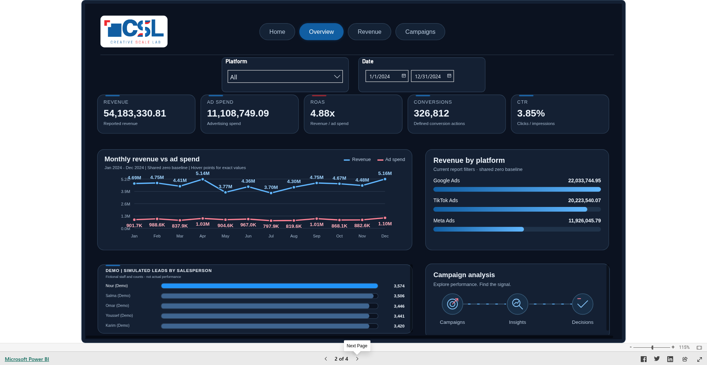
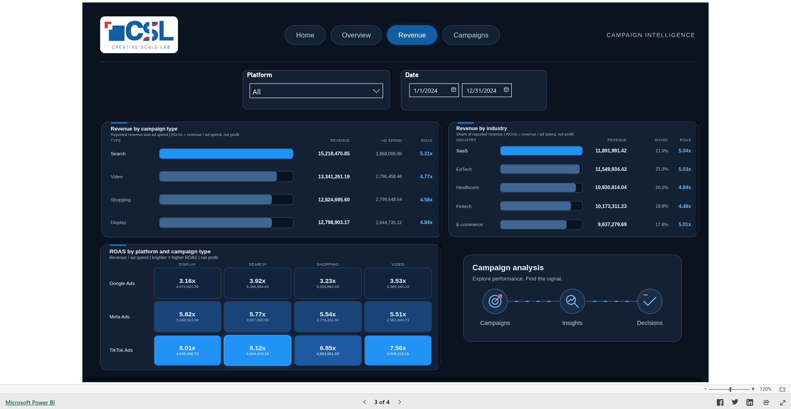
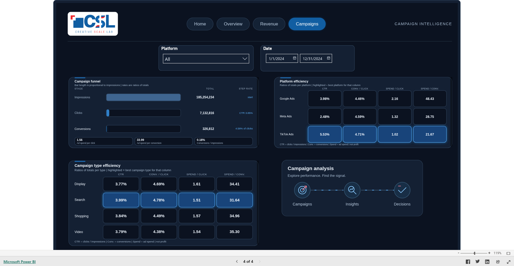

# 📣 CS Lab - Campaign Performance & Sales Intelligence Dashboard


## 📌 Executive Summary
A multi-page interactive Power BI report for a digital marketing agency, styled with CS Lab's colours and a dark theme. It tracks paid campaign performance across **Google, Meta and TikTok** and connects it to a lead and sales view. Pages: Home, Overview, Revenue and Campaigns, with navigation buttons and slicers for platform and date. Custom HTML/CSS visuals (HTML Content visual) add animated headers and charts.

**Live report:** https://app.powerbi.com/view?r=eyJrIjoiNDQyMzZiZmMtMDVmOC00YTlkLTgzMjMtODRkYTg1NTczZWJiIiwidCI6IjI1Y2UwMjYxLWJiZDYtNDljZC1hMWUyLTU0MjYwODg2ZDE1OSJ9

## 🗃️ Data Source
- **Campaign data:** campaign-level ads performance data for Google Ads, Meta Ads and TikTok Ads (report date range: Jan 1 - Dec 31, 2024) with impressions, clicks, ad spend, conversions and revenue.
- **Leads / sales data:** demo table created for this project (fictional salespeople and counts, labelled DEMO in the report).
- This is a practice project built on sample data. It is not CS Lab client data. The data does not specify currency, so no currency symbol is shown, and "conversions" are defined conversion actions, not confirmed sales.

## 🎯 Key Business Questions
1. Which platform and campaign type return the most revenue per unit of ad spend?
2. How do revenue and ad spend move month to month?
3. Where does the funnel (impressions, clicks, conversions) lose volume?
4. Which campaign types and industries drive revenue?

## 📊 Core KPIs (full year, no filters)
- **Revenue:** 54,183,330.81
- **Ad Spend:** 11,108,749.09
- **Conversions:** 326,812
- **ROAS:** 4.88x (revenue / ad spend)
- **CTR:** 3.85% (7,132,816 clicks / 185,254,234 impressions)

Ratios are DAX measures calculated from totals, not averages of row-level columns.

## 🛠️ Technical Highlights
- Power Query cleaning, calendar table, DAX measures (CTR, CPC, CPA, ROAS, MoM, YTD)
- HTML/CSS visuals via DAX measures; custom page navigation
- Platform and date slicers, tested against the CSV totals

## 📸 Screenshots




## 📁 Repository Structure
```text
cs-lab-campaign-sales-dashboard/
├── bi/
│   └── CSL_Dashboard.pbix
├── screenshots/
│   ├── overview.png
│   ├── revenue.png
│   └── campaigns.png
└── README.md
```

## 📁 How to View
1. Open the live report link above, or download `bi/CSL_Dashboard.pbix`.
2. Open the file in Power BI Desktop (the HTML Content custom visual is embedded).
